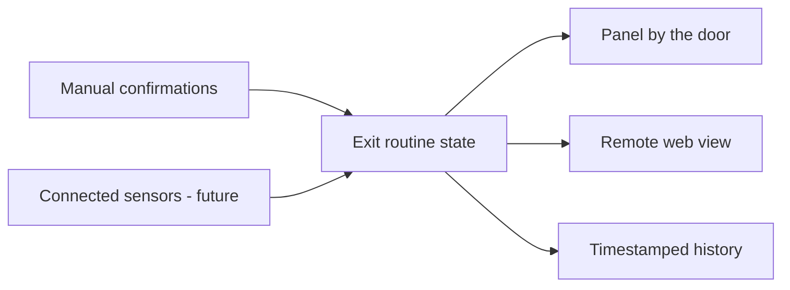

# ExitSafe — Product Discovery and Solution Design

ExitSafe is an academic team project about a small but persistent problem: after leaving home, people may be unsure whether they locked the door, turned off an appliance, or completed another routine safety action. The team studied that uncertainty and designed a way to verify the last exit routine both at the door and remotely.

**Status:** product concept and interactive research report. No connected hardware or production service was built.

## Problem and evidence

The team used qualitative interviews, personas, and a review of existing products to understand when doubts arise and what people do today. Participants described checking twice, taking photos, or returning home. These workarounds add effort and still may not give clear proof later. The interviews informed the concept; they are not a representative market survey.

## Concepts considered

| Concept | Advantage | Main limitation |
| --- | --- | --- |
| Physical checklist at the door | Clear, accessible, inexpensive | Manual confirmation may provide weak proof later |
| Phone checklist | Easy to build and review remotely | Similar to existing reminders and easy to skip |
| Camera-based recognition | Potentially stronger automation | Privacy, cost, and implementation complexity |
| Physical panel plus remote view | Covers the moment of leaving and the later doubt | Requires careful hardware, software, and state design |

The team selected the **panel plus remote view** concept. It combines a quick check at the exit with a web view of the latest routine. Manual confirmation can support an initial version; connected sensors could provide stronger evidence for specific actions later.

## Proposed system

The design keeps each item visible separately. An unknown state must stay unknown; the system should not claim a home is safe when a device has not reported its status. A remote view also makes account security and data privacy part of the solution design.

## Product decisions

- Start with a small set of critical actions and test whether users trust the evidence shown.
- Show when and how each item was confirmed, rather than only a single green status.
- Add sensor integrations gradually because installation cost and reliability vary by household.
- Validate whether the physical panel actually reduces friction compared with a phone-only flow.

## Deliverables and limits

The team produced a research report and an interactive React/Vite presentation of the findings and concept. The system diagram above is a **proposal**, not an implemented architecture. Before claiming product impact, the concept would need usability testing, technical prototyping, and evidence that it reduces uncertainty without creating false reassurance.

**Team:** Laura Cuenca, Josep Audenis, Marc Vendrell, Nil de Creus, and Armand López. This is a group project; the work is presented as a team contribution.
